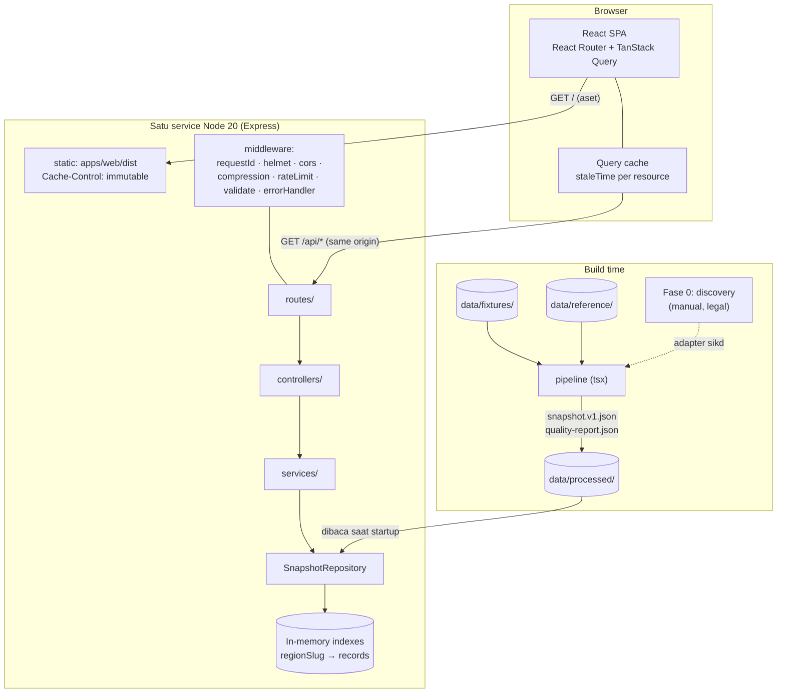
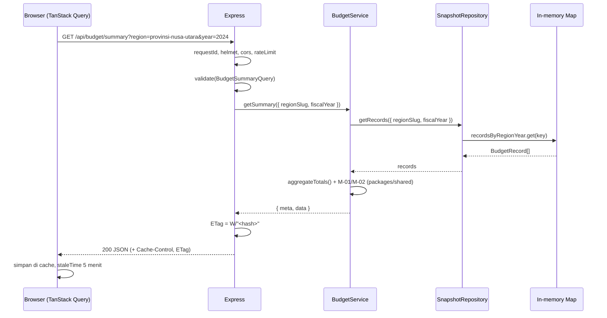

# ARCHITECTURE.md — DanaTerbuka

> **Nama file:** `docs/ARCHITECTURE.md`
> **Versi:** 1.0.0 · **Tanggal:** 1 November 2026 · **Status:** Baseline eksekusi
> **Prasyarat:** `docs/PRD.md` v1.0.0, `docs/DATA_SPEC.md` v1.0.0. ID, route, endpoint, dan tipe wajib identik.
> **Aturan:** Semua nama file, path, fungsi, dan nilai di dokumen ini bersifat normatif. Agent tidak boleh menyimpang tanpa mencatat alasan di `BLOCKERS.md`.

---

## 1. Ringkasan Arsitektur

Satu **monorepo pnpm** dengan empat unit deploy-able/konsumen:

| Unit | Fungsi | Runtime |
|------|--------|---------|
| `apps/web` | SPA React (dashboard, perbandingan, glosarium, metodologi) | Browser |
| `apps/api` | REST API read-only + penyaji build statis web | Node 20 |
| `packages/shared` | Skema Zod, tipe TS, metrik murni, mesin insight, konten glosarium | Netral (dipakai web, api, pipeline, tes) |
| `pipeline` | ETL snapshot JSON (fixture → processed) | Node 20 (`tsx`) |

**Prinsip arsitektur:**

1. **Satu sumber kebenaran logika** — semua rumus & aturan hidup di `packages/shared`; UI **tidak** menghitung sendiri.
2. **Read-only** — tidak ada mutasi data, tidak ada database, tidak ada autentikasi.
3. **Snapshot di memori** — API memuat satu file JSON saat startup; request tidak menyentuh disk/Jaringan.
4. **Ganti data tanpa mengubah UI** — `BudgetRepository` menyembunyikan asal data.
5. **Satu origin saat deploy** — Express menyajikan `/api/*` **dan** aset SPA, sehingga tidak ada CORS di produksi.

### 1.1 Diagram



### 1.2 Alur request (contoh `/api/budget/summary`)



---

## 2. Struktur Folder (lengkap)

```
danaterbuka/
├── apps/
│   ├── api/
│   │   ├── src/
│   │   │   ├── index.ts                  # bootstrap: load env → build app → listen
│   │   │   ├── app.ts                    # createApp() -> Express; dipakai tes Supertest
│   │   │   ├── env.ts                    # EnvSchema (Zod) + exit(1) bila invalid
│   │   │   ├── config/
│   │   │   │   └── constants.ts          # RATE_LIMIT_DEFAULT, SNAPSHOT_PATH, STATIC_DIR
│   │   │   ├── middleware/
│   │   │   │   ├── request-id.ts         # x-request-id atau randomUUID()
│   │   │   │   ├── validate.ts           # validate(schema, "query"|"params")
│   │   │   │   ├── rate-limit.ts         # 120 req/menit/IP pada /api
│   │   │   │   ├── not-found.ts
│   │   │   │   └── error-handler.ts      # format error seragam (§4.3)
│   │   │   ├── routes/
│   │   │   │   ├── index.ts              # mount semua router di /api
│   │   │   │   ├── health.route.ts
│   │   │   │   ├── meta.route.ts
│   │   │   │   ├── regions.route.ts
│   │   │   │   ├── sectors.route.ts
│   │   │   │   ├── budget.route.ts
│   │   │   │   └── insights.route.ts
│   │   │   ├── controllers/
│   │   │   │   ├── health.controller.ts
│   │   │   │   ├── meta.controller.ts
│   │   │   │   ├── regions.controller.ts
│   │   │   │   ├── sectors.controller.ts
│   │   │   │   ├── budget.controller.ts
│   │   │   │   └── insights.controller.ts
│   │   │   ├── services/
│   │   │   │   ├── budget.service.ts     # summary, sectors, trend, compare
│   │   │   │   ├── insight.service.ts    # panggil engine shared
│   │   │   │   └── meta.service.ts       # availableYears, defaults
│   │   │   ├── repositories/
│   │   │   │   ├── budget-repository.ts  # interface + tipe filter
│   │   │   │   ├── snapshot.repository.ts
│   │   │   │   ├── fixture.repository.ts
│   │   │   │   └── index.ts              # createRepository(env)
│   │   │   ├── lib/
│   │   │   │   ├── errors.ts             # AppError + kode error
│   │   │   │   ├── etag.ts               # buildEtag(), isFresh()
│   │   │   │   ├── logger.ts             # pino + redact
│   │   │   │   └── memo.ts               # cache hasil agregasi (Map, max 200)
│   │   │   └── __tests__/
│   │   │       ├── health.test.ts
│   │   │       ├── meta.contract.test.ts
│   │   │       ├── budget.summary.test.ts
│   │   │       ├── budget.sectors.test.ts
│   │   │       ├── budget.trend.test.ts
│   │   │       ├── budget.compare.test.ts
│   │   │       ├── insights.test.ts
│   │   │       ├── validation.test.ts
│   │   │       ├── rate-limit.test.ts
│   │   │       └── fallback.test.ts
│   │   ├── package.json
│   │   ├── tsconfig.json
│   │   └── vitest.config.ts
│   └── web/
│       ├── src/
│       │   ├── main.tsx
│       │   ├── app/
│       │   │   ├── App.tsx               # <HelmetProvider><QueryClientProvider><RouterProvider>
│       │   │   ├── router.tsx            # createBrowserRouter
│       │   │   └── providers.tsx
│       │   ├── pages/
│       │   │   ├── HomePage.tsx
│       │   │   ├── DashboardPage.tsx
│       │   │   ├── ComparePage.tsx
│       │   │   ├── GlossaryPage.tsx
│       │   │   ├── MethodologyPage.tsx
│       │   │   └── NotFoundPage.tsx
│       │   ├── components/
│       │   │   ├── layout/
│       │   │   │   ├── AppHeader.tsx
│       │   │   │   ├── AppFooter.tsx
│       │   │   │   └── PageContainer.tsx
│       │   │   ├── filters/
│       │   │   │   ├── RegionSelect.tsx
│       │   │   │   ├── YearSelect.tsx
│       │   │   │   └── SimpleModeToggle.tsx
│       │   │   ├── dashboard/
│       │   │   │   ├── SummaryCards.tsx
│       │   │   │   ├── SectorChart.tsx
│       │   │   │   ├── TrendChart.tsx
│       │   │   │   ├── InsightPanel.tsx
│       │   │   │   ├── SourceInfoCard.tsx
│       │   │   │   ├── FixtureBadge.tsx
│       │   │   │   └── PeriodNotice.tsx
│       │   │   ├── compare/
│       │   │   │   ├── CompareForm.tsx
│       │   │   │   ├── CompareTable.tsx
│       │   │   │   └── DeltaStat.tsx
│       │   │   ├── states/
│       │   │   │   ├── LoadingSkeleton.tsx
│       │   │   │   ├── EmptyState.tsx
│       │   │   │   └── ErrorState.tsx
│       │   │   ├── common/
│       │   │   │   ├── TermTooltip.tsx
│       │   │   │   ├── ChartTableToggle.tsx
│       │   │   │   ├── DataTable.tsx
│       │   │   │   └── CopyLinkButton.tsx
│       │   │   └── ui/                   # shadcn/ui yang di-generate (button, select, ...)
│       │   ├── hooks/
│       │   │   ├── useFilters.ts         # baca/tulis URLSearchParams
│       │   │   ├── useMeta.ts
│       │   │   ├── useBudgetSummary.ts
│       │   │   ├── useSectorBreakdown.ts
│       │   │   ├── useTrend.ts
│       │   │   ├── useCompare.ts
│       │   │   ├── useInsights.ts
│       │   │   └── useSimpleMode.ts
│       │   ├── lib/
│       │   │   ├── api-client.ts         # fetch wrapper + ApiError
│       │   │   ├── query-client.ts       # staleTime per resource (§5.3)
│       │   │   ├── format.ts             # formatRupiahCompact, formatPercent, formatDate
│       │   │   ├── seo.ts                # <PageMeta> helper (react-helmet-async)
│       │   │   ├── export-csv.ts
│       │   │   └── export-png.ts
│       │   ├── content/
│       │   │   └── microcopy.ts          # seluruh teks UI terpusat
│       │   ├── styles/
│       │   │   ├── index.css             # Tailwind + tokens
│       │   │   └── tokens.css            # CSS variables (sumber token UI_SPEC)
│       │   └── test/
│       │       ├── setup.ts
│       │       └── *.test.tsx
│       ├── public/
│       │   ├── robots.txt
│       │   ├── sitemap.xml
│       │   ├── og-image.png              # 1200×630
│       │   └── favicon.svg
│       ├── index.html
│       ├── vite.config.ts
│       ├── tailwind.config.ts
│       ├── components.json               # konfigurasi shadcn
│       ├── tsconfig.json
│       └── package.json
├── packages/
│   └── shared/
│       ├── src/
│       │   ├── schemas/
│       │   │   ├── region.ts
│       │   │   ├── sector.ts
│       │   │   ├── budget-record.ts
│       │   │   ├── source-meta.ts
│       │   │   ├── snapshot.ts
│       │   │   ├── discovery.ts
│       │   │   ├── query.ts              # skema query API (dipakai api & tes)
│       │   │   ├── api.ts                # response types
│       │   │   └── index.ts
│       │   ├── metrics/
│       │   │   ├── realization.ts        # M-01, M-02
│       │   │   ├── share.ts              # M-03
│       │   │   ├── growth.ts             # M-04
│       │   │   ├── rank.ts               # M-05
│       │   │   ├── delta.ts              # M-06
│       │   │   ├── totals.ts             # aggregateTotals()
│       │   │   ├── round.ts              # round1()
│       │   │   └── index.ts
│       │   ├── insights/
│       │   │   ├── rules.ts              # INS-01..INS-06
│       │   │   ├── engine.ts             # generateInsights()
│       │   │   ├── disclaimers.ts        # teks batas kesimpulan
│       │   │   └── index.ts
│       │   ├── content/
│       │   │   ├── glossary.ts           # ≥ 15 istilah
│       │   │   └── forbidden-words.ts    # daftar kata terlarang insight
│       │   ├── constants.ts              # FISCAL_YEARS, DEFAULT_REGION_SLUG, dll.
│       │   └── index.ts
│       ├── package.json
│       ├── tsconfig.json
│       └── vitest.config.ts
├── pipeline/                             # lihat DATA_SPEC §5.2
│   ├── src/
│   ├── package.json
│   └── tsconfig.json
├── data/
│   ├── fixtures/                         # 5 region, 10 sector, 150 record, sources
│   ├── reference/                        # regions.json, sectors.json, aliases.json, discovery.json
│   └── processed/                        # snapshot.v1.json, quality-report.json (di-commit)
├── e2e/
│   ├── playwright.config.ts
│   ├── tests/
│   │   ├── dashboard.spec.ts
│   │   ├── compare.spec.ts
│   │   ├── share-link.spec.ts
│   │   ├── simple-mode.spec.ts
│   │   ├── glossary.spec.ts
│   │   ├── methodology.spec.ts
│   │   ├── export.spec.ts
│   │   ├── a11y.spec.ts
│   │   └── offline.spec.ts
│   ├── fixtures/                         # data uji e2e (jika perlu)
│   └── package.json
├── docs/
│   ├── PRD.md
│   ├── DATA_SPEC.md
│   ├── ARCHITECTURE.md
│   ├── UI_SPEC.md
│   ├── AGENTS.md
│   ├── TASKS.md
│   ├── data/DISCOVERY.md
│   └── demo/DEMO_SCRIPT.md
├── .github/workflows/ci.yml
├── package.json                          # root scripts + devDeps bersama
├── pnpm-workspace.yaml                   # apps/*, packages/*, pipeline, e2e
├── tsconfig.base.json                    # strict + paths
├── eslint.config.js
├── prettier.config.cjs
├── .nvmrc                                # 20
├── .env.example
├── Dockerfile
├── README.md
├── AGENTS.md                             # salinan ringkas untuk agent (sumber: docs/AGENTS.md)
└── BLOCKERS.md
```

---

## 3. Batas Modul & Aturan Dependensi

### 3.1 Matriks impor

| Dari ↓ / Boleh impor → | `shared` | `apps/api` | `apps/web` | `pipeline` | `node:*` | `react` |
|------------------------|----------|-----------|-----------|-----------|----------|---------|
| `packages/shared` | ★ (internal) | ✗ | ✗ | ✗ | ✗ | ✗ |
| `apps/api` | ✓ | ★ | ✗ | ✗ | ✓ | ✗ |
| `apps/web` | ✓ | ✗ | ★ | ✗ | ✗ | ✓ |
| `pipeline` | ✓ | ✗ | ✗ | ★ | ✓ | ✗ |
| `e2e` | ✓ (tipe saja) | ✗ | ✗ | ✗ | ✓ | ✗ |

**Alasan:** `shared` harus netral lingkungan agar bisa dipakai browser & Node; `web` tidak boleh menyentuh repository/DB; `api` tidak boleh mengimpor komponen React.

### 3.2 Aturan penegakan (ESLint)

```js
// eslint.config.js (potongan normatif)
rules: {
  "no-restricted-imports": ["error", {
    patterns: [
      { group: ["@danaterbuka/api/*", "@danaterbuka/web/*", "@danaterbuka/pipeline/*"],
        message: "shared tidak boleh mengimpor paket aplikasi." },
      { group: ["react", "react-dom", "recharts", "react-router*"],
        message: "API/pipeline tidak boleh mengimpor React." },
      { group: ["**/apps/api/**", "**/repositories/**"],
        message: "Web hanya boleh mengakses data lewat api-client." }
    ]
  }],
  "no-restricted-globals": ["error", { name: "fetch", message: "Web: pakai lib/api-client.ts." }]
}
```

Aturan tambahan:
- `apps/web/src/components/**` **tidak boleh** langsung memanggil `fetch` (wajib lewat `hooks/*` → `lib/api-client.ts`).
- `apps/api/src/routes/**` **tidak boleh** mengimpor `repositories/*` (harus lewat `services/*`).
- Semua impor lintas paket memakai nama paket `@danaterbuka/shared`, bukan path relatif `../../packages/shared`.

### 3.3 Path alias

| Alias | Target |
|-------|--------|
| `@danaterbuka/shared` | `packages/shared/src/index.ts` (via `exports` + `tsconfig` paths) |
| `@/` (web) | `apps/web/src/` |
| `@/` (api) | `apps/api/src/` |

`packages/shared/package.json` memakai `"type": "module"`, `"exports": { ".": "./src/index.ts" }` untuk pengembangan, dan build `dist/` untuk produksi (diputuskan pada T-002; keduanya harus lolos `pnpm typecheck`).

---

## 4. Kontrak API

Base path: `/api`. Semua respons JSON `Content-Type: application/json; charset=utf-8`.

### 4.1 Tabel endpoint

| # | Method | Path | Query (Zod, `packages/shared/src/schemas/query.ts`) | Data response (tipe dari `shared`) | Cache | Error yang mungkin |
|---|--------|------|------------------------------------------------------|-----------------------------------|-------|--------------------|
| 1 | GET | `/api/health` | — | `HealthResponse` (`status`, `dataStatus`, `recordCount`, `snapshotVersion`, `uptimeSeconds`) | `no-store` | 500 |
| 2 | GET | `/api/meta` | — | `MetaResponse` (`meta`, `availableYears`, `latestFinalYear`, `defaultRegionSlug`, `regions`, `sectors`) | `max-age=300` | 500 |
| 3 | GET | `/api/regions` | — | `RegionsResponse` (`meta`, `Region[]`) | `max-age=300` | 500 |
| 4 | GET | `/api/sectors` | — | `SectorsResponse` (`meta`, `Sector[]`) | `max-age=3600` | 500 |
| 5 | GET | `/api/budget/summary` | `BudgetSummaryQuery` | `SummaryResponse` | `max-age=60` | 400, 404, 429, 500 |
| 6 | GET | `/api/budget/sectors` | `BudgetSectorsQuery` | `BudgetSectorsResponse` | `max-age=60` | 400, 404, 429, 500 |
| 7 | GET | `/api/budget/trend` | `BudgetTrendQuery` | `TrendResponse` | `max-age=60` | 400, 404, 429, 500 |
| 8 | GET | `/api/budget/compare` | `CompareQuery` | `CompareResponse` | `max-age=60` | 400, 404, 429, 500 |
| 9 | GET | `/api/insights` | `InsightsQuery` | `InsightsResponse` | `max-age=60` | 400, 404, 429, 500 |
| 10 | GET | `*` (non-`/api`) | — | `index.html` (SPA fallback) | `no-cache` | 500 |

`/api/health` **tidak** memakai envelope `{ meta, data }` (dipakai monitoring; bentuknya dikunci oleh AC-001 PRD).

### 4.2 Skema query (normatif)

```ts
// packages/shared/src/schemas/query.ts
import { z } from "zod";

export const RegionSlugSchema = z.string().regex(/^[a-z0-9]+(?:-[a-z0-9]+)*$/).max(60);
export const YearSchema = z.coerce.number().int().min(2021).max(2025);
export const SectorParamSchema = z.union([z.literal("all"), z.string().regex(/^F\d{2}$/)]);

export const BudgetSummaryQuerySchema = z.object({
  region: RegionSlugSchema.optional(),                 // default: env DEFAULT_REGION_SLUG
  year: YearSchema.optional(),                         // default: latestFinalYear
}).strict();

export const BudgetSectorsQuerySchema = BudgetSummaryQuerySchema.extend({
  limit: z.coerce.number().int().min(1).max(10).default(10),
  sector: SectorParamSchema.default("all"),
}).strict();

export const BudgetTrendQuerySchema = z.object({
  region: RegionSlugSchema.optional(),
  from: YearSchema.optional(),                         // default: max(2021, latestFinalYear - 4)
  to: YearSchema.optional(),                           // default: latestFinalYear
}).strict().refine((q) => !q.from || !q.to || q.from <= q.to, {
  message: "FROM_AFTER_TO",
});

export const CompareQuerySchema = z.object({
  mode: z.enum(["region", "year"]).default("region"),
  a: RegionSlugSchema,
  b: RegionSlugSchema.optional(),
  year: YearSchema.optional(),
  yearA: YearSchema.optional(),
  yearB: YearSchema.optional(),
}).strict().superRefine((q, ctx) => {
  if (q.mode === "region" && !q.b) ctx.addIssue({ code: "custom", message: "B_REQUIRED", path: ["b"] });
  if (q.mode === "year" && (!q.yearA || !q.yearB)) ctx.addIssue({ code: "custom", message: "YEAR_A_B_REQUIRED", path: ["yearA"] });
  if (q.mode === "year" && q.yearA && q.yearB && q.yearA === q.yearB) ctx.addIssue({ code: "custom", message: "YEARS_MUST_DIFFER", path: ["yearB"] });
  if (q.mode === "region" && q.a === q.b) ctx.addIssue({ code: "custom", message: "REGIONS_MUST_DIFFER", path: ["b"] });
});

export const InsightsQuerySchema = z.object({
  region: RegionSlugSchema.optional(),
  year: YearSchema.optional(),
}).strict();
```

**Aturan default (bukan hardcode di controller):** `region` → `env.DEFAULT_REGION_SLUG` (= `provinsi-nusa-utara`); `year` → `meta.latestFinalYear` dari snapshot. Bila `year` yang diminta tidak ada datanya → `404 DATA_NOT_FOUND` (UI menampilkan empty state, EC-01).

### 4.3 Format error seragam

```ts
// packages/shared/src/schemas/api.ts (potongan)
export const ApiErrorSchema = z.object({
  error: z.object({
    code: z.enum([
      "VALIDATION_ERROR",
      "REGION_NOT_FOUND",
      "DATA_NOT_FOUND",
      "NOT_FOUND",
      "RATE_LIMITED",
      "INTERNAL_ERROR",
      "DATA_UNAVAILABLE",
    ]),
    message: z.string(),                       // Bahasa Indonesia, siap tampil
    details: z.unknown().optional(),           // maks 5 item
    requestId: z.string(),
  }),
  meta: z.object({
    snapshotVersion: z.string(),
    dataStatus: z.enum(["ready", "degraded"]),
    isFixture: z.boolean(),
  }).nullable(),
});
```

Contoh:

```json
{
  "error": {
    "code": "VALIDATION_ERROR",
    "message": "Parameter tahun tidak valid. Gunakan tahun antara 2021 dan 2025.",
    "details": [{ "path": "year", "message": "Expected number, received nan" }],
    "requestId": "5f1c2a7e-9f0b-4b47-9c2a-0b6c1c2d3e4f"
  },
  "meta": { "snapshotVersion": "1.0.0", "dataStatus": "ready", "isFixture": true }
}
```

| Code | HTTP | Kapan | Ditangani di |
|------|------|-------|--------------|
| `VALIDATION_ERROR` | 400 | Query/param gagal Zod | `middleware/validate.ts` → `error-handler.ts` |
| `REGION_NOT_FOUND` | 404 | `region` valid secara sintaks tetapi tidak ada di snapshot | `budget.service.ts` |
| `DATA_NOT_FOUND` | 404 | Wilayah ada, tetapi tidak ada record untuk tahun/periode | `budget.service.ts`, `insight.service.ts` |
| `NOT_FOUND` | 404 | Route tidak dikenal | `middleware/not-found.ts` |
| `RATE_LIMITED` | 429 | > 120 req/menit/IP | `middleware/rate-limit.ts` |
| `INTERNAL_ERROR` | 500 | Exception tak terduga (detail tidak dibocorkan; log penuh) | `middleware/error-handler.ts` |
| `DATA_UNAVAILABLE` | 503 | Snapshot **dan** fixture gagal dimuat | `repositories/index.ts` saat startup → 503 pada semua endpoint data |

### 4.4 Bentuk respons data (ringkas)

```ts
// packages/shared/src/schemas/api.ts
export const BudgetSectorsResponseSchema = z.object({
  meta: SourceMetaSchema,
  data: z.object({
    regionSlug: z.string(),
    fiscalYear: z.number().int(),
    totalPagu: z.number().int().nonnegative(),
    totalRealisasi: z.number().int().nonnegative().nullable(),
    realisasiComplete: z.boolean(),
    slices: z.array(SectorSliceSchema).min(1).max(11),   // 10 sektor + 1 agregat "Sektor lainnya"
  }),
});

export const CompareRowSchema = z.object({
  metric: z.enum(["totalPagu", "totalRealisasi", "realizationRate"]),
  label: z.string(),
  aValue: z.number().nullable(),
  bValue: z.number().nullable(),
  delta: z.number().nullable(),          // a - b (M-06)
  deltaPercent: z.number().nullable(),
});

export const CompareResponseSchema = z.object({
  meta: SourceMetaSchema,
  data: z.object({
    mode: z.enum(["region", "year"]),
    a: z.object({ label: z.string(), slug: z.string(), year: z.number().int() }),
    b: z.object({ label: z.string(), slug: z.string(), year: z.number().int() }),
    rows: z.array(CompareRowSchema).length(3),
    topSectorDeltas: z.array(SectorSliceSchema).max(3),
  }),
});
```

`TrendResponse.data.points` memakai `TrendPointSchema` (DATA_SPEC §3.8), urut tahun menaik.

### 4.5 Middleware (urutan wajib)

| Urutan | Middleware | Konfigurasi | Catatan |
|--------|-----------|-------------|---------|
| 1 | `requestId` | Ambil `x-request-id` (validasi UUID) atau `randomUUID()`; set header respons | Dipakai di log & error |
| 2 | `pino-http` | `logger`, `genReqId: (req) => req.id`, `redact: ["req.headers.authorization","req.headers.cookie"]` | Log terstruktur |
| 3 | `helmet` | Lihat §6.1 | CSP produksi |
| 4 | `cors` | `origin: env.CORS_ORIGINS.length ? env.CORS_ORIGINS : false`, `methods: ["GET"]` | Produksi satu origin → mati |
| 5 | `compression` | `threshold: 1024` | JSON & HTML |
| 6 | `express.json({ limit: "32kb" })` | Body tidak dipakai, tetap aman | — |
| 7 | `rateLimit` | `windowMs: 60_000`, `limit: 120`, `standardHeaders: "draft-7"`, `skip` untuk aset statis | Hanya `/api` |
| 8 | Router `/api` | `validate(query)` per route | — |
| 9 | `static` + SPA fallback | `express.static(STATIC_DIR, { immutable: true, maxAge: "1y" })` untuk `/assets/*`; `index.html` `no-cache` | Hanya produksi |
| 10 | `notFound` | 404 `NOT_FOUND` | — |
| 11 | `errorHandler` | `(err, req, res, next)` — 4 argumen; **wajib terakhir** | Satu-satunya tempat format error |

`validate` menulis hasil ke `res.locals.query` (bukan memutasi `req.query`), agar objek asli tetap tersedia untuk log.

### 4.6 Keputusan caching

| Lapisan | Mekanisme | Nilai |
|---------|-----------|-------|
| Repository | Snapshot dimuat **sekali** saat startup menjadi objek immutable + indeks `Map<string, BudgetRecord[]>` (`regionSlug|year`, `regionSlug`, `sectorId`) | O(1) lookup |
| Service | Memo agregasi per key (`region|year|limit`) memakai `Map` dengan batas 200 entri (LRU sederhana: hapus entri tertua) | Hitungan ≤ 150 record, memo tetap murah |
| HTTP | `ETag: W/"<sha1(body).slice(0,16)>-<snapshotVersion>"`; balas `304` bila `If-None-Match` cocok | `etag.ts` |
| HTTP | `Cache-Control` per endpoint (§4.1): data `public, max-age=60, stale-while-revalidate=300`; metadata `max-age=300/3600`; health `no-store` | — |
| Web | TanStack Query `staleTime` (§5.3), `gcTime` 30 menit, `retry: 1`, `refetchOnWindowFocus: false` | — |
| Static | `/assets/*` hash-named → `public, max-age=31536000, immutable`; `index.html` → `no-cache` | — |

**Alasan `max-age=60`:** snapshot hanya berubah saat deploy/pipeline ulang, tetapi TTL pendek menghindari data basi di antara dua deploy tanpa perlu purge CDN.

---

## 5. Frontend

### 5.1 Routing

`createBrowserRouter` dengan `createRoutesFromElements`. Detail halaman & komponen ada di `UI_SPEC.md`; daftar route final:

| Path | Elemen | Sumber state |
|------|--------|--------------|
| `/` | `HomePage` | — |
| `/dashboard` | `DashboardPage` | `?region&year&sector&simple` |
| `/bandingkan` | `ComparePage` | `?mode&a&b&year&yearA&yearB&simple` |
| `/glosarium` | `GlossaryPage` | `?q&simple` |
| `/metodologi` | `MethodologyPage` | hash anchor (`#INS-01`) |
| `*` | `NotFoundPage` | — |

**Aturan state:** `useFilters()` membaca/menulis `URLSearchParams`; tidak ada state filter di Zustand/Context. Satu-satunya preferensi lokal: `localStorage["danaterbuka.simple"]` (fallback bila param `simple` tidak ada).

### 5.2 Query keys (TanStack Query)

| Hook | Key | Endpoint |
|------|-----|----------|
| `useMeta` | `["meta"]` | `/api/meta` |
| `useRegions` | `["regions"]` | `/api/regions` |
| `useBudgetSummary` | `["budget","summary",region,year]` | `/api/budget/summary` |
| `useSectorBreakdown` | `["budget","sectors",region,year,limit]` | `/api/budget/sectors` |
| `useTrend` | `["budget","trend",region,from,to]` | `/api/budget/trend` |
| `useCompare` | `["budget","compare",mode,a,b,year,yearA,yearB]` | `/api/budget/compare` |
| `useInsights` | `["insights",region,year]` | `/api/insights` |

### 5.3 Konfigurasi cache web

```ts
// apps/web/src/lib/query-client.ts
export const queryClient = new QueryClient({
  defaultOptions: {
    queries: {
      staleTime: 5 * 60_000,        // data anggaran
      gcTime: 30 * 60_000,
      retry: 1,
      refetchOnWindowFocus: false,
      refetchOnReconnect: true,
    },
  },
});
```

| Resource | staleTime | Alasan |
|----------|-----------|--------|
| `meta`, `regions`, `sectors` | `Infinity` (satu sesi) | Referensi statis per deploy |
| summary, sectors, trend, insights | 5 menit | Sesuai `Cache-Control: 60s` + toleransi navigasi |
| compare | 2 menit | Lebih sering berganti kombinasi |

### 5.4 Error & empty handling di klien

`api-client.ts` melempar `ApiError` dengan `code`, `message`, `requestId`. Pemetaan:

| Kondisi | Komponen |
|---------|----------|
| `isLoading` | `LoadingSkeleton` (tinggi tetap untuk mencegah CLS) |
| `error.code === "DATA_NOT_FOUND"` / `REGION_NOT_FOUND` | `EmptyState` (bukan error merah) |
| `error.code === "RATE_LIMITED"` | `ErrorState` + pesan "Terlalu banyak permintaan. Coba lagi sebentar." |
| error lain | `ErrorState` + tombol `refetch()` |
| `meta.dataStatus === "degraded"` | `PeriodNotice` varian peringatan |

---

## 6. Keamanan & Operasional

### 6.1 Header keamanan (helmet)

```ts
helmet({
  contentSecurityPolicy: {
    directives: {
      defaultSrc: ["'self'"],
      scriptSrc: ["'self'"],
      styleSrc: ["'self'", "'unsafe-inline'"],   // kebutuhan tooltip & chart library
      imgSrc: ["'self'", "data:"],
      connectSrc: ["'self'"],
      fontSrc: ["'self'"],
      objectSrc: ["'none'"],
      frameAncestors: ["'none'"],
      baseUri: ["'self'"],
    },
  },
  referrerPolicy: { policy: "strict-origin-when-cross-origin" },
  crossOriginEmbedderPolicy: false,             // agar aset same-origin tidak diblokir
})
```

**Trade-off tercatat:** `'unsafe-inline'` pada `style-src` diterima karena Recharts/shadcn menulis inline style; tidak ada `script-src 'unsafe-inline'`.

### 6.2 Environment variable

```bash
# .env.example (normatif)
NODE_ENV=development
PORT=3001
DATA_ADAPTER=snapshot            # snapshot | fixture
SNAPSHOT_PATH=./data/processed/snapshot.v1.json
STATIC_DIR=./apps/web/dist
CORS_ORIGINS=                    # kosong = same-origin saja
RATE_LIMIT_MAX=120
LOG_LEVEL=info
DEFAULT_REGION_SLUG=provinsi-nusa-utara

# web (build time)
VITE_API_BASE_URL=/api           # produksi same-origin
VITE_SITE_URL=https://danaterbuka.example   # UNVERIFIED: ganti dengan domain final
```

`env.ts` memvalidasi dengan Zod; jika invalid → log error + `process.exit(1)` (gagal cepat, bukan diam-diam).

### 6.3 Logging

`pino` level dari env, format JSON produksi / `pino-pretty` dev. Field wajib: `requestId`, `method`, `url` (tanpa query sensitif), `status`, `durationMs`. Dilarang mencatat body respons penuh.

### 6.4 Graceful shutdown

`SIGTERM`/`SIGINT` → `server.close()` → `process.exit(0)` setelah maksimum 5 detik.

---

## 7. SEO untuk SPA

### 7.1 Implementasi

| Komponen | Detail |
|----------|--------|
| `react-helmet-async` | `<HelmetProvider>` di `app/App.tsx`; setiap halaman memakai `<PageMeta title description canonical path image />` |
| Metadata per halaman | Tabel §7.2; `canonical` memakai `VITE_SITE_URL` + path (tanpa query agar tidak duplikat) |
| OG statis | `index.html` memuat `og:title`, `og:description`, `og:image` (`/og-image.png`, 1200×630), `og:type=website`, `twitter:card=summary_large_image` — menjadi fallback sebelum React hydrate |
| `robots.txt` | `User-agent: *` / `Allow: /` / `Disallow: /api/` / `Sitemap: <VITE_SITE_URL>/sitemap.xml` |
| `sitemap.xml` | 5 URL publik (`/`, `/dashboard`, `/bandingkan`, `/glosarium`, `/metodologi`), `lastmod` = tanggal rilis, tanpa query |
| JSON-LD | `WebSite` + `Dataset` (name, description, creator, license, temporalCoverage) di `/metodologi` & `/dashboard` |

### 7.2 Metadata halaman

| Route | `<title>` | `description` |
|-------|-----------|---------------|
| `/` | `DanaTerbuka — Memahami Anggaran, Mengawasi Pembangunan` | `Lihat anggaran dan realisasi daerah dalam bahasa sederhana, lengkap dengan sumber dan batas kesimpulan.` |
| `/dashboard` | `Dashboard Anggaran — DanaTerbuka` | `Pagu, realisasi, dan alokasi per sektor untuk wilayah dan tahun pilihan Anda.` |
| `/bandingkan` | `Bandingkan Anggaran — DanaTerbuka` | `Bandingkan dua wilayah atau dua tahun dan bagikan hasilnya lewat tautan.` |
| `/glosarium` | `Glosarium Istilah Anggaran — DanaTerbuka` | `Arti sederhana istilah anggaran seperti pagu, realisasi, dan SILPA.` |
| `/metodologi` | `Metodologi & Sumber Data — DanaTerbuka` | `Rumus, sumber, lisensi, dan keterbatasan data yang dipakai DanaTerbuka.` |
| `*` | `Halaman tidak ditemukan — DanaTerbuka` | `Halaman yang Anda cari tidak tersedia.` |

### 7.3 Keterbatasan SEO SPA (trade-off diterima)

| Keterbatasan | Dampak | Mitigasi | Alasan diterima |
|--------------|--------|----------|-----------------|
| HTML awal kosong (CSR) | Crawler tanpa JS (termasuk sebagian bot media sosial) tidak melihat konten halaman | OG statis di `index.html`; konten inti juga tersedia di `/metodologi` (teks statis di bundle) | Prerender/SSR menambah kompleksitas & waktu; audiens lomba bukan mesin pencari |
| Query param tidak diindeks | Tautan `?region=...` tidak menghasilkan halaman terpisah | Canonical tanpa query; konten utama tetap di URL dasar | Menghindari duplikasi konten |
| Waktu render bergantung JS | LCP bergantung bundle | Code-split route, preload font lokal, budget 220 KB | Diukur pada NFR-001/NFR-003 |

**Keputusan:** tetap SPA. Opsi SSG (mis. `react-snap`) dicatat sebagai Fase 3/out-of-scope; tidak dikerjakan M0–M6.

---

## 8. Library Chart: Perbandingan & Keputusan

Kriteria berbobot untuk konteks lomba (tim mahasiswa, waktu singkat, aksesibilitas, bundle).

| Kriteria | Recharts | ECharts |
|----------|----------|---------|
| Integrasi React | Deklaratif (komponen JSX), tanpa wrapper | Butuh wrapper `echarts-for-react` atau `useEffect` manual |
| Ukuran bundle (gzip, perkiraan) | ± 100–130 KB (tree-shake terbatas) | ± 150–300 KB untuk chart dasar (canvas + core), tree-shaking lebih baik |
| Aksesibilitas | Render SVG/DOM → mudah diberi `role="img"` + `aria-label`, mudah diuji Testing Library | Render `<canvas>` → perlu `aria` manual + tabel alternatif wajib |
| Kesesuaian kebutuhan | Bar, line, stacked bar, tooltip, legend — semua ada | Semua ada + peta/heatmap (tidak dipakai) |
| Kurva belajar agent | Rendah (API JSX) | Sedang (opsi objek besar) |
| Risiko SSR/SPA | Rendah | Rendah |
| Kemudahan PNG export | `html-to-image`/`dom-to-image` pada container | Bawaan (`getDataURL`) |

**Keputusan: Recharts** (+ `html-to-image` untuk FR-061).
**Alasan:** SVG membuat aksesibilitas & tes lebih mudah (NFR-005/NFR-006), integrasi React deklaratif mempercepat agent, dan kebutuhan hanya bar/line. **Konsekuensi:** ukuran bundle dipantau di T-037; bila melewati 220 KB, route `/bandingkan` di-`lazy()` dan chart dimuat dinamis.

---

## 9. Deploy: Perbandingan & Keputusan

| Aspek | **A. Satu service** (Express menyajikan `apps/web/dist` + `/api`) | **B. Terpisah** (web di Vercel/Netlify/CF Pages, API di Render/Railway) |
|-------|-------------------------------------------------------------------|----------------------------------------------------------------------|
| Jumlah URL | 1 (tanpa CORS) | 2 (perlu CORS + env `VITE_API_BASE_URL` absolut) |
| Biaya | 1 instance gratis/murah | 2 layanan; free tier API sering tidur |
| Kompleksitas build | `pnpm build` → satu artefak | 2 pipeline deploy + preview terpisah |
| Risiko demo | Cold start API = seluruh app lambat | Cold start API = dashboard kosong/error; web tetap tampil |
| Caching/CDN | Bisa pakai CDN di depan satu origin | CDN web gratis (edge), API tetap di origin |
| SEO | Sama (SPA) | Sama (SPA), sedikit lebih baik untuk aset statis |
| Debugging | 1 log stream | 2 log stream |
| Waktu setup agent | Rendah | Sedang |

**Keputusan: A — satu service.** Alasan: satu URL mengurangi titik gagal saat demo, menghapus CORS, dan memungkinkan `pnpm start` tunggal untuk juri.

### 9.1 Risiko cold start & mitigasi

| Risiko | Status | Mitigasi |
|--------|--------|----------|
| Free tier menidurkan instance setelah ~15 menit idle (angka platform **UNVERIFIED**) | Perlu diukur pada T-039 | (1) Cron ping `/api/health` setiap 10 menit; (2) *warm-up* manual 5 menit sebelum presentasi; (3) fallback lokal `pnpm start:demo` (fixture, tanpa internet); (4) pertimbangkan plan berbayar termurah atau Fly.io dengan 1 mesin selalu aktif |
| Build lambat di platform | Rendah | `Dockerfile` multi-stage; snapshot di-commit sehingga build tidak menjalankan pipeline |
| Port/host salah | Rendah | `PORT` dari env platform, `HOST=0.0.0.0` |

### 9.2 Artefak deploy

```dockerfile
# Dockerfile (normatif, multi-stage)
FROM node:20-alpine AS build
WORKDIR /app
RUN corepack enable
COPY pnpm-lock.yaml package.json pnpm-workspace.yaml ./
COPY apps ./apps
COPY packages ./packages
COPY pipeline ./pipeline
RUN pnpm install --frozen-lockfile
RUN pnpm build            # web build + api build

FROM node:20-alpine AS runtime
WORKDIR /app
ENV NODE_ENV=production
COPY --from=build /app/apps/web/dist ./apps/web/dist
COPY --from=build /app/apps/api/dist ./apps/api/dist
COPY --from=build /app/node_modules ./node_modules
COPY --from=build /app/apps/api/node_modules ./apps/api/node_modules
COPY data/processed ./data/processed
EXPOSE 3001
CMD ["node", "apps/api/dist/index.js"]
```

Perintah terkait: `pnpm start` (produksi), `pnpm start:demo` (`DATA_ADAPTER=fixture pnpm start`), `pnpm dev` (web 5173 + api 3001, proxy `/api`).

---

## 10. Konfigurasi Build & Tooling

### 10.1 Script root (`package.json`)

```json
{
  "scripts": {
    "dev": "pnpm -r --parallel dev",
    "build": "pnpm --filter @danaterbuka/shared build && pnpm --filter @danaterbuka/web build && pnpm --filter @danaterbuka/api build",
    "start": "node apps/api/dist/index.js",
    "start:demo": "cross-env DATA_ADAPTER=fixture node apps/api/dist/index.js",
    "lint": "eslint .",
    "typecheck": "pnpm -r typecheck",
    "test": "pnpm -r test",
    "test:coverage": "pnpm -r test:coverage",
    "test:e2e": "playwright test --config e2e/playwright.config.ts",
    "test:e2e:offline": "cross-env OFFLINE=1 playwright test --config e2e/playwright.config.ts",
    "pipeline": "pnpm --filter @danaterbuka/pipeline start",
    "pipeline:check": "pnpm --filter @danaterbuka/pipeline start -- --check",
    "fixtures:generate": "pnpm --filter @danaterbuka/pipeline fixtures:generate",
    "fixtures:verify": "pnpm --filter @danaterbuka/pipeline fixtures:verify",
    "build:analyze": "pnpm --filter @danaterbuka/web build:analyze"
  }
}
```

### 10.2 Vite

```ts
// apps/web/vite.config.ts (potongan)
export default defineConfig({
  plugins: [react(), tailwindcss()],
  build: {
    target: "es2020",
    sourcemap: true,
    rollupOptions: { output: { manualChunks: { charts: ["recharts"] } } },
  },
  server: { proxy: { "/api": "http://localhost:3001" } },
});
```

### 10.3 CI (`.github/workflows/ci.yml`)

| Job | Perintah | Gate |
|-----|----------|------|
| `quality` | `pnpm install --frozen-lockfile`, `pnpm lint`, `pnpm typecheck` | 0 error |
| `unit` | `pnpm test -- --coverage` | semua lulus; `shared` ≥ 90% |
| `build` | `pnpm build` + `pnpm fixtures:verify` + `pnpm pipeline:check` | artefak terbentuk, hash stabil |
| `e2e` | `pnpm --filter @danaterbuka/web build`, `pnpm start &`, `pnpm test:e2e` | semua lulus, 0 axe serious/critical |

Urutan wajib: `quality` → `unit` → `build` → `e2e`. Merge diblokir jika salah satu merah.

---

## 11. Traceability Arsitektur → Requirement

| Requirement | Keputusan arsitektur | Task |
|-------------|----------------------|------|
| FR-001 | `SnapshotRepository` memuat file saat startup, indeks di memori | T-012 |
| FR-002 | Envelope `{ meta, data }` di semua endpoint data | T-013 |
| FR-005 | `SNAPSHOT_INVALID` → `FixtureRepository` + `dataStatus: degraded` | T-012 |
| FR-020/021/022 | URL search params via `useFilters`, `CopyLinkButton` | T-023, T-035 |
| FR-030/031 | `/api/budget/compare` + `ComparePage` | T-015, T-026 |
| FR-040/041 | `packages/shared/insights` + `/api/insights` | T-016, T-027 |
| NFR-003 | `manualChunks.charts` + lazy route | T-037 |
| NFR-004 | memo agregasi + indeks Map | T-012 |
| NFR-005/006 | Recharts SVG + tabel alternatif + axe di CI | T-021, T-036, T-041 |
| NFR-007/008 | helmet + rate limit middleware | T-011 |
| NFR-009 | fallback repository | T-012 |
| NFR-014/015 | react-helmet-async + `sitemap.xml`/`robots.txt` | T-035, T-038 |
| NFR-016 | tanpa cookie; CSP ketat; `localStorage` hanya `simple` | T-036 |
| NFR-019 | `SourceInfoCard` + footer atribusi | T-024 |

---

## 12. Self-check

- [x] **Tidak ada endpoint karangan**: 9 endpoint internal semuanya didefinisikan dengan query schema, tipe respons, dan kode error; tidak ada klaim API pemerintah (itu domain `DATA_SPEC.md`, status `Unverified`).
- [x] **Konsisten dengan dokumen lain**: route (`/dashboard`, `/bandingkan`, `/glosarium`, `/metodologi`), param (`region`, `year`, `sector`, `simple`, `mode`, `a`, `b`, `yearA`, `yearB`), tipe (`SummaryResponse`, `InsightsResponse`, dst.), dan ID FR/NFR sama dengan PRD & DATA_SPEC.
- [x] **Setiap keputusan punya alasan tertulis**: Recharts vs ECharts (§8), satu service vs terpisah (§9), `max-age=60` (§4.6), `'unsafe-inline'` style (§6.1), SPA SEO (§7.3).
- [x] **Setiap risiko cold start punya mitigasi terukur**: cron ping, warm-up, fallback lokal, opsi plan (§9.1), dengan status *UNVERIFIED* untuk angka idle platform.
- [x] **Aturan dependensi dapat ditegakkan mesin**: matriks §3.1 + konfigurasi ESLint §3.2 + gate CI §10.3.
- [x] **Tidak ada requirement tanpa rumah**: tabel §11 memetakan FR/NFR kunci ke komponen dan task.

---

**Berhenti di sini.** Dokumen berikutnya: `docs/UI_SPEC.md` — tunggu instruksi "lanjut".
