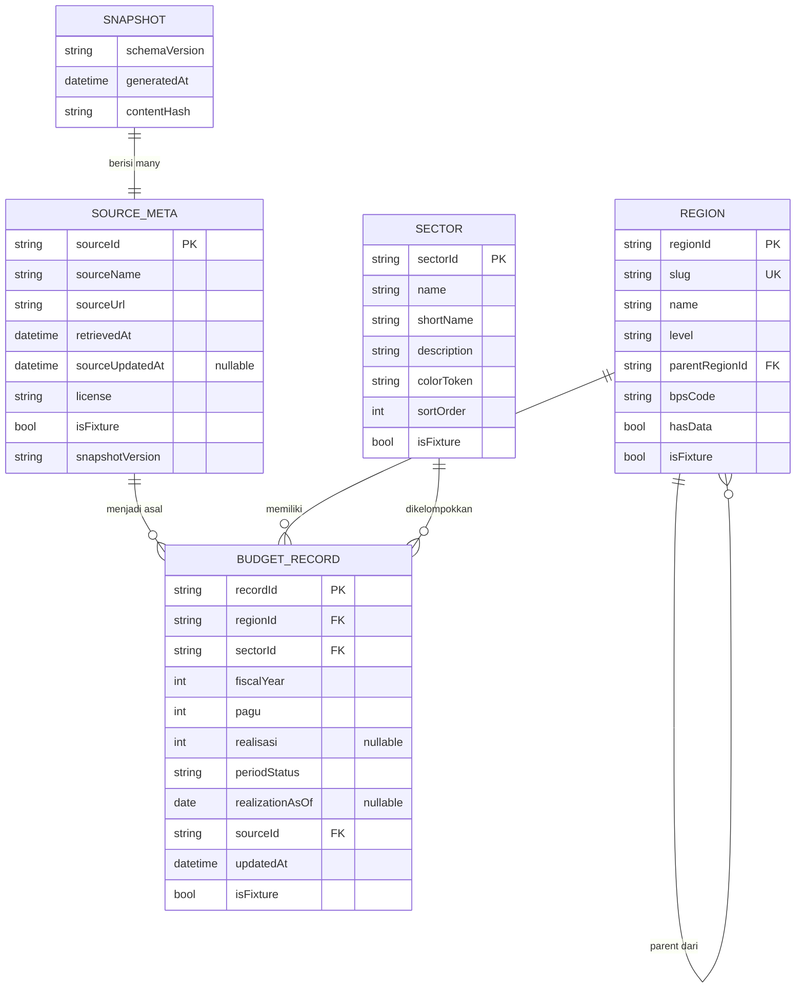
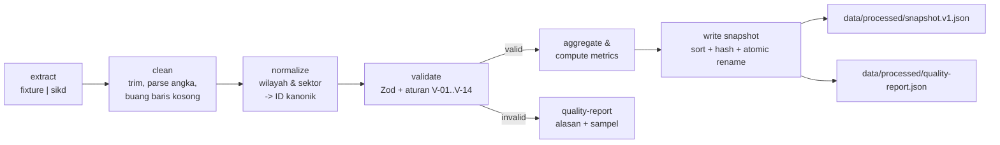

# DATA_SPEC.md — DanaTerbuka

> **Nama file:** `docs/DATA_SPEC.md`
> **Versi:** 1.0.0 · **Tanggal:** 1 November 2026 · **Status:** Baseline eksekusi
> **Prasyarat:** `docs/PRD.md` (v1.0.0). Semua ID (`FR-`, `NFR-`, `M-`, `INS-`, `A-`) harus sama dengan PRD.
> **Aturan:** Tidak ada endpoint, nama kolom, lisensi, atau angka resmi yang boleh dikarang. Semua yang belum dicek ditandai **UNVERIFIED** dan wajib diselesaikan pada Fase 0 (T-004) atau diganti fixture.

---

## 1. Ringkasan & Prinsip Data

| ID | Prinsip | Konsekuensi teknis |
|----|---------|--------------------|
| DP-01 | **Satu bentuk kanonik** | Semua sumber dipetakan ke `Snapshot v1.0.0`. UI hanya mengenal bentuk ini. |
| DP-02 | **Tidak ada angka tanpa sumber** | Setiap `BudgetRecord` menunjuk `sourceId` di `snapshot.sources[]`. |
| DP-03 | **Data kotor ditolak, bukan ditebak** | Record gagal validasi dibuang + dicatat di `quality-report.json`; dilarang mengisi nilai karangan. |
| DP-04 | **Deterministik** | Generator fixture ber-seed tetap; pipeline mengurutkan output; hasil dua kali run identik (hash sama). |
| DP-05 | **Fixture berlabel** | `isFixture: true` mengalir dari snapshot → API `meta` → badge UI. Nama wilayah fixture fiktif (A-16 PRD). |
| DP-06 | **Bisa diganti tanpa mengubah UI** | Semua akses data lewat interface `BudgetRepository`; UI tidak tahu asal data. |
| DP-07 | **Patuh sumber** | Hormati `robots.txt`, 1 request/2 detik, User-Agent jelas, tanpa bypass login/CAPTCHA. |

---

## 2. Protokol Data Discovery (Fase 0)

Tujuan: memastikan agent **tidak mengarang** struktur data. Timebox total: **60 menit**. Jika habis tanpa hasil yang dapat diverifikasi → tandai `Not Available`, lanjut ke fixture (tidak memblokir milestone).

### 2.1 Langkah wajib (urut, tidak boleh dilompati)

| Langkah | Aksi konkret | Alat | Keluaran |
|---------|--------------|------|----------|
| D1 | Cek `robots.txt` setiap domain sebelum request lain | `curl -sS https://<domain>/robots.txt` | Kutipan aturan `Disallow` yang relevan di tabel §2.3 |
| D2 | Buka halaman portal, cari menu unduh/API/dataset | `webfetch` (format `markdown`) | Catat jalur menu + URL persis |
| D3 | Uji apakah ada endpoint mesin (JSON/CSV/XLSX) tanpa login | `curl -I` dan `curl -sS -o NUL -w "%{http_code} %{content_type}"` | Status HTTP + `Content-Type` |
| D4 | Jika ada berkas: unduh **satu** contoh (maks 5 MB), periksa header & 5 baris pertama | `Get-Content -TotalCount 6` (CSV) / `python -c` atau `npx csv-parse` | Nama kolom **persis** (huruf besar/kecil, spasi, pemisah) |
| D5 | Catat cakupan: daftar wilayah, rentang tahun, granularitas (bulanan/tahunan), kapan terakhir diperbarui | Manual dari halaman "tentang/metadata" | Isi kolom §2.3 |
| D6 | Catat lisensi & atribusi yang diminta portal | Halaman "Ketentuan"/"Lisensi" | Teks lisensi persis + URL |
| D7 | Putuskan status: `Verified` (bisa diakses & diparse), `Unverified` (ada tapi belum terbukti), `Not Available` (tidak ada akses legal) | — | Baris tabel §2.3 terisi lengkap |
| D8 | Tulis hasil ke `docs/data/DISCOVERY.md` + salinan JSON di `data/reference/discovery.json` | — | Berkas ada, lolos `pnpm data:discovery:check` |

### 2.2 Aturan etika & legal (mengikat)

| ID | Aturan |
|----|--------|
| DE-01 | Dilarang melakukan scraping halaman HTML secara massal. Prioritaskan API resmi, tautan unduhan resmi, atau dataset Satu Data. |
| DE-02 | Maksimum 1 request per 2 detik per domain; maksimum 20 request per sesi discovery. |
| DE-03 | User-Agent wajib: `DanaTerbuka/1.0 (academic competition; contact: <email-tim>)`. |
| DE-04 | Dilarang melewati login, CAPTCHA, atau token yang tidak diberikan publik. |
| DE-05 | Dilarang mengunggah ulang dataset mentah penuh; hanya snapshot agregat + atribusi. |
| DE-06 | Jika lisensi melarang redistribusi, produk hanya menampilkan agregat + tautan ke sumber, dan `license` diisi teks aslinya. |
| DE-07 | Setiap angka di UI harus dapat ditelusuri ke `sourceUrl` + `retrievedAt`. |

### 2.3 Tabel Verified / Unverified / Not Available (diisi pada T-004)

> **Status saat dokumen ini ditulis: SEMUA `Unverified`.** Tidak ada satu pun klaim ketersediaan data yang boleh dianggap benar sebelum T-004 selesai.

| ID | Sumber (kandidat) | URL kandidat | Bentuk akses yang dicari | Cakupan yang perlu dicek | Status awal | Status final (T-004) | Bukti (HTTP/Content-Type/kutipan) | Lisensi |
|----|-------------------|--------------|--------------------------|--------------------------|-------------|----------------------|-----------------------------------|---------|
| DS-01 | Portal SIKD — DJPK Kemenkeu | `https://djpk.kemenkeu.go.id/portal/` | API JSON / unduh CSV-XLSX / hanya HTML | Wilayah (prov/kab/kota), tahun, granularitas, tanggal update | Unverified | _isi_ | _isi_ | _isi_ |
| DS-02 | Satu Data Indonesia | `https://data.go.id/` | API CKAN / unduh CSV | Dataset APBD/realisasi yang relevan | Unverified | _isi_ | _isi_ | _isi_ |
| DS-03 | BPS (statistik pendukung) | `https://www.bps.go.id/` | API / unduh | Jumlah penduduk, IPM (untuk konteks bila dipakai) | Unverified | _isi_ | _isi_ | _isi_ |
| DS-04 | Portal open data pemerintah daerah | _cari saat T-004_ | CSV/JSON | 1–2 daerah contoh | Unverified | _isi_ | _isi_ | _isi_ |
| DS-05 | Kemenkeu — APBD / realisasi publikasi berkala | _cari saat T-004_ | PDF/XLSX | Rekap nasional | Unverified | _isi_ | _isi_ | _isi_ |

**Aturan keputusan (dipakai agent tanpa bertanya):**

| Kondisi | Keputusan |
|---------|-----------|
| ≥ 1 sumber `Verified` dengan data wilayah + tahun + pagu + realisasi | Implementasikan adapter `sikd` (T-010 lanjutan) memakai kolom **persis** hasil D4; tetap pertahankan fixture sebagai fallback. |
| Sumber `Verified` tetapi hanya pagu (tanpa realisasi) | `realisasi = null`, `periodStatus = "approved"`; insight INS-02/INS-04 tidak dihasilkan. |
| Hanya `Unverified` / `Not Available` | **Kirim dengan fixture**, tulis keterbatasan di `/metodologi`, dan catat di `BLOCKERS.md`. Ini keputusan sah, bukan kegagalan. |
| Struktur kolom berubah di kemudian hari | Perbaiki hanya `pipeline/src/extract/*.ts` + `data/reference/aliases.json`; skema kanonik & UI tidak berubah. |

### 2.4 Berkas keluaran discovery

```
docs/data/DISCOVERY.md          # tabel 2.3 versi panjang + catatan
data/reference/discovery.json   # mesin-baca; divalidasi skema di §3.7
```

---

## 3. Data Contract (Kanonik v1.0.0)

Semua skema berada di `packages/shared/src/schemas/` dan **hanya** di sana. API memvalidasi output dengan skema yang sama; web memakai tipe hasil `z.infer`.

### 3.1 Primitif & konvensi

| Aspek | Konvensi |
|-------|----------|
| Uang | Bilangan bulat rupiah (`number`, satuan Rp, tanpa desimal). Contoh `2400000000000`. Dilarang menyimpan string terformat. |
| Persen | `number` 1 desimal (0–999, boleh > 100), dihitung di `packages/shared/src/metrics`. |
| Tanggal | `string` ISO-8601 UTC (`2026-11-01T00:00:00.000Z`) untuk timestamp; `YYYY-MM-DD` untuk tanggal kalender. |
| Tahun fiskal | `number` integer, 2000–2100. |
| ID record | Deterministik: `` `${regionId}:${sectorId}:${fiscalYear}` `` (contoh `ID-FIX-P01:F07:2024`). |
| Slug | `^[a-z0-9]+(?:-[a-z0-9]+)*$`, dipakai di URL (`?region=provinsi-nusa-utara`). |
| Null vs 0 | `null` = "tidak tersedia/belum dirilis". `0` = nilai terukur nol. Dilarang menukar keduanya. |

### 3.2 `Region`

```ts
// packages/shared/src/schemas/region.ts
import { z } from "zod";

export const RegionLevelSchema = z.enum(["national", "province", "city", "regency"]);

export const RegionSchema = z
  .object({
    regionId: z.string().regex(/^ID-[A-Z0-9]{2,4}-[A-Z0-9]{2,6}$/, "INVALID_REGION_ID"),
    slug: z.string().regex(/^[a-z0-9]+(?:-[a-z0-9]+)*$/, "INVALID_SLUG"),
    name: z.string().min(3).max(80),
    level: RegionLevelSchema,
    parentRegionId: z.string().nullable(),
    bpsCode: z.string().regex(/^\d{2,4}$/).nullable(),
    hasData: z.boolean(),
    isFixture: z.boolean(),
  })
  .strict();

export type Region = z.infer<typeof RegionSchema>;
```

Contoh (fixture, fiktif):

```json
{
  "regionId": "ID-FIX-P01",
  "slug": "provinsi-nusa-utara",
  "name": "Provinsi Nusa Utara",
  "level": "province",
  "parentRegionId": null,
  "bpsCode": null,
  "hasData": true,
  "isFixture": true
}
```

### 3.3 `Sector` (Fungsi Belanja)

```ts
// packages/shared/src/schemas/sector.ts
export const SectorSchema = z
  .object({
    sectorId: z.string().regex(/^F\d{2}$/, "INVALID_SECTOR_ID"), // F01..F10 (referensi), F11+ hanya untuk data uji
    name: z.string().min(3).max(60),
    shortName: z.string().min(2).max(24),
    description: z.string().min(10).max(160),
    iconKey: z.enum(["health", "education", "infrastructure", "economy", "environment",
                     "housing", "security", "tourism", "religion", "general"]),
    colorToken: z.enum(["sector-1","sector-2","sector-3","sector-4","sector-5",
                        "sector-6","sector-7","sector-8","sector-9","sector-10"]),
    sortOrder: z.number().int().min(1).max(99),
    isFixture: z.boolean(),
  })
  .strict();

export type Sector = z.infer<typeof SectorSchema>;
```

Referensi 10 fungsi (A-13 PRD, **UNVERIFIED** terhadap Permendagri — diverifikasi pada T-004):

| sectorId | name (fixture) | shortName | colorToken | sortOrder |
|----------|----------------|-----------|------------|-----------|
| F01 | Pelayanan Umum | Pelayanan | sector-1 | 1 |
| F02 | Pertahanan | Pertahanan | sector-2 | 2 |
| F03 | Ketertiban dan Keamanan | Keamanan | sector-3 | 3 |
| F04 | Ekonomi | Ekonomi | sector-4 | 4 |
| F05 | Lingkungan Hidup | Lingkungan | sector-5 | 5 |
| F06 | Perumahan dan Fasilitas Umum | Infrastruktur | sector-6 | 6 |
| F07 | Kesehatan | Kesehatan | sector-7 | 7 |
| F08 | Pariwisata dan Budaya | Pariwisata | sector-8 | 8 |
| F09 | Agama | Agama | sector-9 | 9 |
| F10 | Pendidikan | Pendidikan | sector-10 | 10 |

> **Catatan AC-011 (PRD):** skenario "satu wilayah/tahun memiliki 12 sektor" diuji dengan **dataset sintetis khusus tes** (`F11`, `F12` buatan, hanya di file tes, tidak masuk fixture maupun referensi). Skema mengizinkan `F\d{2}` sehingga aturan overflow "Top 10 + Sektor lainnya" dapat diuji tanpa menambah taksonomi resmi.

### 3.4 `BudgetRecord`

```ts
// packages/shared/src/schemas/budget-record.ts
export const PeriodStatusSchema = z.enum(["approved", "partial", "final"]);

export const BudgetRecordSchema = z
  .object({
    recordId: z.string().min(8).max(60),
    regionId: z.string(),
    sectorId: z.string().regex(/^F\d{2}$/),
    fiscalYear: z.number().int().min(2000).max(2100),
    pagu: z.number().int().nonnegative(),          // rupiah
    realisasi: z.number().int().nonnegative().nullable(),
    periodStatus: PeriodStatusSchema,
    realizationAsOf: z.string().regex(/^\d{4}-\d{2}-\d{2}$/).nullable(),
    sourceId: z.string(),
    updatedAt: z.string().datetime(),
    isFixture: z.boolean(),
  })
  .strict()
  .superRefine((rec, ctx) => {
    if (rec.periodStatus === "partial" && rec.realizationAsOf === null) {
      ctx.addIssue({ code: "custom", message: "PARTIAL_REQUIRES_AS_OF", path: ["realizationAsOf"] });
    }
    if (rec.periodStatus === "approved" && rec.realisasi !== null) {
      ctx.addIssue({ code: "custom", message: "APPROVED_MUST_NOT_HAVE_REALISASI", path: ["realisasi"] });
    }
    if (rec.periodStatus === "final" && rec.realisasi === null) {
      ctx.addIssue({ code: "custom", message: "FINAL_REQUIRES_REALISASI", path: ["realisasi"] });
    }
  });

export type BudgetRecord = z.infer<typeof BudgetRecordSchema>;
```

**Semantik `periodStatus`:**

| Nilai | Arti | `pagu` | `realisasi` | `realizationAsOf` | Tampilan |
|-------|------|--------|-------------|-------------------|----------|
| `approved` | Pagu ditetapkan, realisasi belum dirilis | wajib | **null** | null | "Realisasi belum dirilis" |
| `partial` | Realisasi berjalan s.d. tanggal tertentu | wajib | wajib | wajib | "per 30 Juni 2025" |
| `final` | Realisasi akhir tahun (audited/closed) | wajib | wajib | boleh null | Tanpa catatan tambahan |

### 3.5 `SourceMeta`

```ts
// packages/shared/src/schemas/source-meta.ts
export const SourceMetaSchema = z
  .object({
    sourceId: z.string().min(3).max(40),
    sourceName: z.string().min(3).max(120),
    sourceUrl: z.string().url(),
    retrievedAt: z.string().datetime(),
    sourceUpdatedAt: z.string().datetime().nullable(),
    license: z.string().min(2).max(200),          // teks persis dari portal; "UNVERIFIED" bila belum dicek
    licenseUrl: z.string().url().nullable(),
    attribution: z.string().min(3).max(300),
    isFixture: z.boolean(),
    snapshotVersion: z.string().regex(/^\d+\.\d+\.\d+$/),
    dataStatus: z.enum(["ready", "degraded"]),
    recordCount: z.number().int().nonnegative(),
  })
  .strict();

export type SourceMeta = z.infer<typeof SourceMetaSchema>;
```

Catatan: `recordCount` dihitung saat API memuat snapshot (bukan ditulis di file), sehingga `meta` selalu akurat.

### 3.6 `Snapshot` (artefak pipeline)

```ts
// packages/shared/src/schemas/snapshot.ts
export const SnapshotSchema = z
  .object({
    schemaVersion: z.literal("1.0.0"),
    generatedAt: z.string().datetime(),
    contentHash: z.string().regex(/^[a-f0-9]{64}$/),   // sha256 isi kanonik tanpa generatedAt
    sources: z.array(SourceMetaSchema.omit({ recordCount: true, dataStatus: true })).min(1),
    regions: z.array(RegionSchema).min(1),
    sectors: z.array(SectorSchema).min(1),
    records: z.array(BudgetRecordSchema),
  })
  .strict();

export type Snapshot = z.infer<typeof SnapshotSchema>;
```

### 3.7 `DiscoveryReport` (keluaran Fase 0)

```ts
// packages/shared/src/schemas/discovery.ts
export const DiscoveryStatusSchema = z.enum(["verified", "unverified", "not_available"]);

export const DiscoveryEntrySchema = z
  .object({
    id: z.string().regex(/^DS-\d{2}$/),
    name: z.string().min(3).max(120),
    url: z.string().url(),
    accessType: z.enum(["api", "csv", "xlsx", "json", "html", "pdf", "none"]),
    coverage: z.string().max(300),
    status: DiscoveryStatusSchema,
    evidence: z.string().max(500),
    license: z.string().max(200),
    checkedAt: z.string().datetime(),
  })
  .strict();

export const DiscoveryReportSchema = z
  .object({
    schemaVersion: z.literal("1.0.0"),
    entries: z.array(DiscoveryEntrySchema).length(5),
    decision: z.enum(["use_real_source", "use_fixture", "partial_real"]),
    notes: z.string().max(2000),
  })
  .strict();
```

### 3.8 Tipe turunan API (dipakai web & api)

```ts
// packages/shared/src/schemas/api.ts
export const SummaryDataSchema = z.object({
  regionSlug: z.string(),
  fiscalYear: z.number().int(),
  totalPagu: z.number().int().nonnegative(),
  totalRealisasi: z.number().int().nonnegative().nullable(),
  realizationRate: z.number().nullable(),          // 1 desimal
  remainingBudget: z.number().int().nullable(),
  sectorCount: z.number().int(),
  realisasiComplete: z.boolean(),                  // false bila ada sektor tanpa realisasi
  periodStatus: PeriodStatusSchema,
});

export const SummaryResponseSchema = z.object({ meta: SourceMetaSchema, data: SummaryDataSchema });

export const SectorSliceSchema = z.object({
  sectorId: z.string(),
  name: z.string(),
  shortName: z.string(),
  pagu: z.number().int().nonnegative(),
  realisasi: z.number().int().nonnegative().nullable(),
  realizationRate: z.number().nullable(),
  share: z.number().nullable(),                    // % terhadap total pagu, 1 desimal
  rank: z.number().int().positive(),
  isAggregate: z.boolean(),                        // true untuk "Sektor lainnya"
});

export const TrendPointSchema = z.object({
  fiscalYear: z.number().int(),
  pagu: z.number().int().nonnegative(),
  realisasi: z.number().int().nonnegative().nullable(),
  periodStatus: PeriodStatusSchema,
});

export const InsightSchema = z.object({
  ruleId: z.enum(["INS-01","INS-02","INS-03","INS-04","INS-05","INS-06"]),
  severity: z.enum(["info","attention","caution"]),
  sentence: z.string().min(20).max(240),
  limitation: z.string().min(20).max(240),
  supportingValues: z.record(z.string(), z.union([z.number(), z.string()])),
});

export const InsightsResponseSchema = z.object({
  meta: SourceMetaSchema,
  data: z.object({
    items: z.array(InsightSchema).min(3).max(5),
    disclaimer: z.string().min(20).max(300),
  }),
});
```

### 3.9 Contoh respons (data fixture, bukan fakta)

```json
{
  "meta": {
    "sourceId": "SRC-FIXTURE-01",
    "sourceName": "Dataset contoh DanaTerbuka (bukan data resmi)",
    "sourceUrl": "https://example.invalid/danaterbuka/fixture",
    "retrievedAt": "2026-11-01T00:00:00.000Z",
    "sourceUpdatedAt": null,
    "license": "CC0-1.0 (data sintetis)",
    "licenseUrl": null,
    "attribution": "Dibuat otomatis oleh generator fixture DanaTerbuka; tidak merepresentasikan anggaran daerah nyata.",
    "isFixture": true,
    "snapshotVersion": "1.0.0",
    "dataStatus": "ready",
    "recordCount": 150
  },
  "data": {
    "regionSlug": "provinsi-nusa-utara",
    "fiscalYear": 2024,
    "totalPagu": 2400000000000,
    "totalRealisasi": 1800000000000,
    "realizationRate": 75.0,
    "remainingBudget": 600000000000,
    "sectorCount": 10,
    "realisasiComplete": true,
    "periodStatus": "final"
  }
}
```

> `example.invalid` dipakai sesuai RFC 2606 — **bukan** URL nyata. Adapter riil wajib mengisi URL hasil verifikasi T-004.

---

## 4. ERD & Data Dictionary

### 4.1 ERD



### 4.2 Data dictionary

| Entitas | Field | Tipe | Wajib | Aturan/Contoh | Sumber |
|---------|-------|------|-------|---------------|--------|
| Region | `regionId` | string | Ya | `^ID-[A-Z0-9]{2,4}-[A-Z0-9]{2,6}$`, contoh `ID-FIX-P01` | Referensi wilayah / BPS code |
| Region | `slug` | string | Ya | `provinsi-nusa-utara`; unik; dipakai di URL | Turunan nama |
| Region | `name` | string | Ya | `Provinsi Nusa Utara` | Sumber/registry |
| Region | `level` | enum | Ya | `national\|province\|city\|regency` | — |
| Region | `parentRegionId` | string \| null | Ya | Province → `null`; kota/kab → `regionId` provinsi | — |
| Region | `bpsCode` | string \| null | Ya | 2–4 digit; `null` untuk fixture | BPS (UNVERIFIED) |
| Region | `hasData` | boolean | Ya | `false` untuk `kabupaten-rimba-hulu` | Turunan pipeline |
| Region | `isFixture` | boolean | Ya | `true` selama data sintetis | Generator |
| Sector | `sectorId` | string | Ya | `F01`…`F10` (referensi) | Klasifikasi fungsi (UNVERIFIED) |
| Sector | `shortName` | string | Ya | ≤ 24 char, `Kesehatan` | — |
| Sector | `colorToken` | enum | Ya | `sector-1`…`sector-10` (lihat UI_SPEC) | — |
| Sector | `sortOrder` | int | Ya | 1–10 | — |
| BudgetRecord | `recordId` | string | Ya | `ID-FIX-P01:F07:2024` | Turunan |
| BudgetRecord | `regionId` | string | Ya | harus ada di `regions[]` | — |
| BudgetRecord | `sectorId` | string | Ya | harus ada di `sectors[]` | — |
| BudgetRecord | `fiscalYear` | int | Ya | 2021–2025 | Sumber |
| BudgetRecord | `pagu` | int ≥ 0 | Ya | rupiah, contoh `720000000000` | Sumber |
| BudgetRecord | `realisasi` | int ≥ 0 \| null | Ya | `null` bila belum dirilis | Sumber |
| BudgetRecord | `periodStatus` | enum | Ya | `approved\|partial\|final` | Sumber + tanggal cut-off |
| BudgetRecord | `realizationAsOf` | date \| null | Ya | wajib bila `partial` | Sumber |
| BudgetRecord | `sourceId` | string | Ya | merujuk `sources[]` | — |
| BudgetRecord | `updatedAt` | datetime | Ya | ISO UTC | Waktu ingest |
| SourceMeta | `retrievedAt` | datetime | Ya | waktu data diambil pipeline | Pipeline |
| SourceMeta | `sourceUpdatedAt` | datetime \| null | Ya | `null` bila portal tidak menyatakan | Portal |
| SourceMeta | `license` | string | Ya | teks persis; `UNVERIFIED` bila belum dicek | Portal |
| Snapshot | `contentHash` | string | Ya | sha256 isi kanonik tanpa `generatedAt` | Pipeline |
| Snapshot | `generatedAt` | datetime | Ya | waktu build (satu-satunya field non-deterministik) | Pipeline |

---

## 5. Pipeline ETL

### 5.1 Alur



### 5.2 Struktur file pipeline

```
pipeline/
├── src/
│   ├── index.ts              # CLI: pnpm pipeline [--source=fixture|sikd] [--check]
│   ├── extract/
│   │   ├── fixture.ts        # baca data/fixtures/*.json
│   │   └── sikd.ts           # adapter riil (stub sampai T-004; throw SOURCE_NOT_CONFIGURED)
│   ├── clean.ts              # cleanRows()
│   ├── normalize.ts          # normalizeRegion(), normalizeSector()
│   ├── validate.ts           # validateRecords() -> {accepted, rejected}
│   ├── quality.ts            # buildQualityReport(), issue codes
│   ├── write.ts              # writeSnapshotAtomic(), computeContentHash()
│   └── types.ts              # RawRow, CleanRow, DataIssue
└── src/**/*.test.ts          # Vitest
```

### 5.3 Signature fungsi (mengikat)

```ts
// pipeline/src/types.ts
export interface RawRow {
  sourceId: string;
  regionName: string;
  sectorName: string;
  fiscalYear: string | number;
  pagu: string | number;
  realisasi: string | number | null;
  periodStatus?: string;
  realizationAsOf?: string | null;
  updatedAt?: string;
}

export interface DataIssue {
  code: IssueCode;          // lihat §5.5
  severity: "error" | "warning";
  rowIndex: number;
  field?: string;
  message: string;
  rawSample: string;        // maks 120 char, PII-free
}

export interface PipelineResult {
  snapshot: Snapshot;
  quality: QualityReport;
}
```

| Fungsi | File | Kontrak |
|--------|------|---------|
| `extractFixture()` | `extract/fixture.ts` | `(): Promise<RawRow[]>`; deterministik |
| `extractSikd()` | `extract/sikd.ts` | `(): Promise<RawRow[]>`; **stub** melempar `SOURCE_NOT_CONFIGURED` sampai T-004 |
| `cleanRows(rows)` | `clean.ts` | `(RawRow[]) => { rows: CleanRow[]; issues: DataIssue[] }`; tidak pernah throw untuk input kotor |
| `normalizeRegion(name)` | `normalize.ts` | `(string) => Region \| null`; lowercase, hapus diakritik, alias lookup |
| `normalizeSector(name)` | `normalize.ts` | `(string) => Sector \| null` |
| `validateRecords(rows)` | `validate.ts` | `(CleanRow[]) => { accepted: BudgetRecord[]; issues: DataIssue[] }` |
| `buildSnapshot(records, sources)` | `../write.ts` | `(BudgetRecord[], SourceMeta[]) => Snapshot` (mengurutkan + hash) |
| `writeSnapshotAtomic(snapshot)` | `write.ts` | tulis `*.tmp` lalu `rename`; tidak pernah menulis file parsial |
| `runPipeline({ source })` | `index.ts` | `({ source: "fixture"\|"sikd" }) => Promise<PipelineResult>` |

### 5.4 Aturan pembersihan (`clean.ts`)

| ID | Aturan | Contoh input → output |
|----|--------|-----------------------|
| CL-01 | Trim spasi, hapus NBSP (`\u00A0`), hapus BOM (`\uFEFF`) | `"  Kesehatan\u00A0"` → `"Kesehatan"` |
| CL-02 | Angka: hapus `Rp`, spasi, dan titik pemisah ribuan | `"Rp 1.234.567"` → `1234567` |
| CL-03 | Desimal koma → titik, lalu `Math.round` ke rupiah | `"1.234,5"` → `1235` |
| CL-04 | Tanda kurung = negatif | `"(500)"` → `-500` (lalu ditolak NEGATIVE_PAGU) |
| CL-05 | Placeholder kosong → `null` | `""`, `"-"`, `"—"`, `"n/a"`, `"N/A"` → `null` |
| CL-06 | Tahun: ambil 4 digit pertama | `"2024 (audited)"` → `2024` |
| CL-07 | Baris tanpa `regionName` **dan** `sectorName` → dibuang sebagai baris kosong, dicatat `EMPTY_ROW` | `"   "` → discarded |
| CL-08 | Duplikat `(region, sector, year)` → pertahankan yang `updatedAt` terbaru, catat `DUPLICATE_ROW` | 2 baris 2024 Kesehatan → 1 |
| CL-09 | `realisasi` kosong dengan `periodStatus=final` → `null` + issue `FINAL_WITHOUT_REALISASI` (record ditolak) | — |
| CL-10 | Jangan pernah interpolasi/mengisi nilai hilang dengan rata-rata atau 0 | — |

### 5.5 Kode isu & validasi

| Kode | Severity | Penyebab | Aksi | Pesan laporan |
|------|----------|----------|------|---------------|
| `NEGATIVE_PAGU` | error | `pagu < 0` | tolak record | "Pagu negatif tidak valid." |
| `NEGATIVE_REALISASI` | error | `realisasi < 0` | tolak record | "Realisasi negatif tidak valid." |
| `UNKNOWN_REGION` | error | nama wilayah tidak ada di registry | tolak record | "Wilayah tidak dikenali: `<nama>`." |
| `UNKNOWN_SECTOR` | error | nama sektor tidak ada di aliases | tolak record | "Sektor tidak dikenali: `<nama>`." |
| `INVALID_YEAR` | error | tahun di luar 2000–2100 | tolak record | "Tahun tidak valid." |
| `MISSING_PERIOD_STATUS` | error | `periodStatus` kosong/tak dikenal | tolak record | "Status periode wajib diisi." |
| `REALISASI_EXCEEDS_SANITY` | warning | `realisasi > 3 × pagu` | terima + flag | "Realisasi > 300% pagu; periksa satuan." |
| `EMPTY_ROW` | warning | baris kosong | buang | "Baris kosong diabaikan." |
| `DUPLICATE_ROW` | warning | duplikat kunci | simpan terbaru | "Duplikat digabung." |
| `FINAL_WITHOUT_REALISASI` | error | `final` + `realisasi=null` | tolak | "Status final wajib punya realisasi." |
| `PARTIAL_WITHOUT_AS_OF` | error | `partial` + `realizationAsOf=null` | tolak | "Realisasi sebagian wajib punya tanggal cut-off." |
| `SCHEMA_MISMATCH` | error | gagal `BudgetRecordSchema.safeParse` | tolak | "Struktur record tidak sesuai skema." |
| `SNAPSHOT_INVALID` | error (runtime) | snapshot gagal parse saat API start | fallback fixture | "Snapshot tidak valid; memakai data contoh." |
| `SNAPSHOT_TOO_LARGE` | error (build) | > 2 MB | gagal exit 1 | "Snapshot melebihi 2 MB." |

### 5.6 Normalisasi kode wilayah & sektor

- Registry wilayah: `data/reference/regions.json` (array `Region` + `aliases: string[]`).
- Registry sektor: `data/reference/sectors.json` + `data/reference/aliases.json`:

```json
{
  "sectors": {
    "F07": ["kesehatan", "kesehatan daerah", "urusan kesehatan", "health"],
    "F10": ["pendidikan", "pendidikan dan kebudayaan", "education"],
    "F06": ["perumahan dan fasilitas umum", "pekerjaan umum", "infrastruktur", "pupr"]
  },
  "regions": {
    "provinsi-nusa-utara": ["nusa utara", "prov. nusa utara", "propinsi nusa utara"]
  }
}
```

- Algoritma pencocokan: `normalizeKey(s) = s.toLowerCase().normalize("NFD").replace(/[\u0300-\u036f]/g, "").replace(/[^a-z0-9]+/g, " ").trim()`; cocokkan **exact** terhadap daftar alias, lalu fallback ke nama kanonik. Tidak ada fuzzy matching (mencegah salah petakan).
- Jika > 1 kandidat cocok → tolak dengan `UNKNOWN_SECTOR` (ambigu) dan catat, jangan pilih acak.

### 5.7 Output & idempotensi

| Aspek | Ketentuan |
|-------|-----------|
| Output | `data/processed/snapshot.v1.json`, `data/processed/quality-report.json` |
| Urutan | `records` diurut `regionId`, lalu `sectorId`, lalu `fiscalYear`; `regions` diurut `sortOrder`/`name`; `sectors` diurut `sortOrder` |
| Serialisasi | `JSON.stringify(value, null, 2)` + newline akhir; kunci objek ditulis dalam urutan skema |
| Hash | `sha256` atas JSON kanonik **tanpa** `generatedAt` |
| Idempotensi | Dua kali `pnpm pipeline` pada input sama → `contentHash` identik; `--check` exit 0 jika hash sama dengan file lama, exit 1 jika berbeda |
| Atomik | tulis `snapshot.v1.json.tmp` → `fs.rename` (mencegah file setengah jadi) |
| Ukuran | tolak > 2 MB (EC-14) |

### 5.8 Laporan kualitas (format)

```json
{
  "schemaVersion": "1.0.0",
  "generatedAt": "2026-11-01T00:00:00.000Z",
  "source": "fixture",
  "received": 153,
  "accepted": 150,
  "rejected": 3,
  "warnings": 2,
  "reasons": [
    { "code": "NEGATIVE_PAGU", "count": 1, "samples": ["row 12: pagu=-500000000"] },
    { "code": "UNKNOWN_REGION", "count": 1, "samples": ["row 48: regionName=Atlantis"] },
    { "code": "MISSING_PERIOD_STATUS", "count": 1, "samples": ["row 77: periodStatus=''"] }
  ],
  "durationMs": 812,
  "inputChecksum": "3f2c…"
}
```

Aturan: `received = accepted + rejected`; `rejected = Σ reasons[].count`; jika tidak seimbang → pipeline gagal (`QUALITY_MISMATCH`).

---

## 6. Strategi Fixture

### 6.1 Prinsip

| ID | Aturan |
|----|--------|
| FX-01 | Fixture **fiktif** (nama wilayah karangan) dan **wajib** `isFixture: true` pada setiap entity. |
| FX-02 | Generator deterministik: seed `20260101`, PRNG `mulberry32` (fungsi 8 baris, tanpa dependensi). |
| FX-03 | Semua nilai rupiah kelipatan `1_000_000` (Rp 1 juta) agar rapi dan mudah diverifikasi. |
| FX-04 | Nilai anchor (tabel 6.3) **wajib persis** — dipakai acceptance criteria PRD (AC-010, AC-031, AC-040). |
| FX-05 | Fixture disimpan sebagai JSON statis hasil generate (bukan dihitung saat runtime) supaya build reproducible. |
| FX-06 | Data rusak sengaja disimpan terpisah di `data/fixtures/corrupt/` dan **tidak** masuk snapshot utama. |

### 6.2 Wilayah & cakupan

| regionId | slug | Nama | Level | Cakupan data |
|----------|------|------|-------|--------------|
| ID-FIX-P01 | `provinsi-nusa-utara` | Provinsi Nusa Utara | province | 2021–2025 (2025 `approved`) |
| ID-FIX-P02 | `provinsi-selat-timur` | Provinsi Selat Timur | province | 2021–2024 (`final` 2024) |
| ID-FIX-P03 | `provinsi-bukit-selatan` | Provinsi Bukit Selatan | province | 2022–2024 (mulai 2022) |
| ID-FIX-C01 | `kota-bahari` | Kota Bahari | city | 2022–2024 |
| ID-FIX-C02 | `kabupaten-rimba-hulu` | Kabupaten Rimba Hulu | regency | **tidak ada data** (`hasData: false`, EC-03) |

Total record: P01 50 + P02 40 + P03 30 + C01 30 + C02 0 = **150** record (10 sektor × tahun yang tersedia). Nilai ini menjadi `meta.recordCount` yang dipakai pada contoh §3.9 dan §5.8.

### 6.3 Nilai anchor (WAJIB persis)

**`provinsi-nusa-utara` tahun 2024** (`final`):

| sectorId | Sektor | Pagu (Rp) | Realisasi (Rp) | % Realisasi |
|----------|--------|-----------|----------------|-------------|
| F07 | Kesehatan | 720.000.000.000 | 550.000.000.000 | 76,4% |
| F10 | Pendidikan | 600.000.000.000 | 470.000.000.000 | 78,3% |
| F06 | Infrastruktur | 336.000.000.000 | 240.000.000.000 | 71,4% |
| F04 | Ekonomi | 288.000.000.000 | 180.000.000.000 | 62,5% |
| F01 | Pelayanan | 192.000.000.000 | 170.000.000.000 | 88,5% |
| F03 | Keamanan | 96.000.000.000 | 80.000.000.000 | 83,3% |
| F05 | Lingkungan | 72.000.000.000 | 40.000.000.000 | 55,6% |
| F08 | Pariwisata | 48.000.000.000 | 30.000.000.000 | 62,5% |
| F09 | Agama | 24.000.000.000 | 30.000.000.000 | **125,0%** (EC-04) |
| F02 | Pertahanan | 24.000.000.000 | 10.000.000.000 | 41,7% |
| **Total** | — | **2.400.000.000.000** | **1.800.000.000.000** | **75,0%** |

Konsekuensi yang harus dipenuhi fixture:

| Keperluan tes | Nilai anchor |
|---------------|--------------|
| AC-010 | totalPagu 2,4 T, totalRealisasi 1,8 T, rate 75,0%, gap Rp 600,0 M |
| AC-040 (INS-01) | pangsa F07 = 30,0% (≥ ambang 25%) |
| INS-02 | F02 rate 41,7% (< 50%) dan gap 14 M ≥ 0,5% total pagu (12 M) |
| INS-03 | `provinsi-nusa-utara` F04 2023 pagu = 240.000.000.000 → 2024 = 288.000.000.000 (naik 20,0%) |
| INS-04 | gap F07 = 170 M = 7,08% total pagu (≥ 5%) |
| INS-05 | top-3 pangsa = 69,0% (≥ 50%) |
| EC-04 | F09 realisasi > pagu |
| EC-06 | `kota-bahari` 2022 F09 pagu = 0, realisasi = 0, rate = null |
| EC-02 | `provinsi-nusa-utara` 2025 semua sektor `approved`, `realisasi = null` |

**Aturan generator:** untuk setiap (wilayah, tahun, sektor) selain anchor, `pagu` diacak dalam rentang [40 M, 900 M]; rasio realisasi diacak [0,35; 1,02]; kecuali `periodStatus=approved` → `realisasi=null`. Setelah generate, total pagu per (wilayah, tahun) **wajib** diskalakan/disesuaikan pada sektor terbesar agar total = target tabel 6.4 (toleransi 0).

**Target total pagu per wilayah/tahun** (dipakai agar insight & perbandingan konsisten):

| Wilayah | 2021 | 2022 | 2023 | 2024 | 2025 |
|---------|------|------|------|------|------|
| provinsi-nusa-utara | 1.900 M | 2.050 M | 2.200 M | **2.400 M** | 2.500 M |
| provinsi-selat-timur | 1.600 M | 1.700 M | 1.850 M | 2.000 M | — |
| provinsi-bukit-selatan | — | 1.300 M | 1.400 M | 1.500 M | — |
| kota-bahari | — | 700 M | 760 M | 820 M | — |
| kabupaten-rimba-hulu | — | — | — | — | — |

(M = miliar rupiah; "—" = tidak ada record.)

### 6.4 Berkas fixture

```
data/fixtures/
├── regions.json         # 5 Region (fiktif)
├── sectors.json         # 10 Sector
├── budget-records.json  # 150 BudgetRecord (hasil generator)
├── sources.json         # 1 SourceMeta fixture
└── corrupt/
    ├── negative-pagu.json
    ├── unknown-region.json
    └── missing-period-status.json
```

Perintah:

```bash
pnpm fixtures:generate     # tulis ulang fixtures dari seed (deterministik)
pnpm fixtures:verify       # assert nilai anchor §6.3 -> exit 0/1
pnpm pipeline              # fixtures -> data/processed/snapshot.v1.json
```

### 6.5 Adapter: beralih fixture ↔ data asli

```ts
// apps/api/src/repositories/budget-repository.ts
export interface BudgetRepository {
  getMeta(): SourceMeta;
  listRegions(): Region[];
  listSectors(): Sector[];
  getRecords(filter: { regionSlug?: string; fiscalYear?: number }): BudgetRecord[];
}
```

| Mode | Env | Perilaku | `isFixture` |
|------|-----|----------|-------------|
| Snapshot (default) | `DATA_ADAPTER=snapshot` | Baca `data/processed/snapshot.v1.json` saat startup | Diambil dari `source.isFixture` |
| Fixture | `DATA_ADAPTER=fixture` | Bangun in-memory dari `data/fixtures/*.json` (abaikan `processed/`) | `true` |
| Riil | `DATA_ADAPTER=snapshot` setelah `pnpm pipeline --source=sikd` | Snapshot berisi data sumber asli | `false` → badge hilang otomatis |

Aturan: **UI tidak boleh membaca env atau nama file**; hanya endpoint `/api/*`. Pergantian sumber = satu variabel env + satu kali pipeline, tanpa mengubah kode React.

---

## 7. Metrik Turunan (rumus pasti)

Semua fungsi di `packages/shared/src/metrics/` bersifat murni dan 100% di-unit-test.

| ID | Nama | Rumus | Kasus tepi | Contoh |
|----|------|-------|-----------|--------|
| M-01 | `realizationRate` | `realisasi === null \|\| pagu <= 0 ? null : round1(realisasi / pagu * 100)` | pagu 0 → `null`; realisasi null → `null`; > 100 diperbolehkan (EC-04) | 1,8 T / 2,4 T → `75.0` |
| M-02 | `remainingBudget` | `realisasi === null ? null : pagu - realisasi` | boleh negatif (realisasi > pagu) | 2,4 T − 1,8 T → `600000000000` |
| M-03 | `sectorShare` | `totalPagu <= 0 ? null : round1(sectorPagu / totalPagu * 100)` | total 0 → `null` | 720 M / 2,4 T → `30.0` |
| M-04 | `yoyGrowth` | `(prev === null \|\| prev <= 0 \|\| curr === null) ? null : round1((curr - prev) / prev * 100)` | tahun sebelumnya tidak ada → `null`; prev 0 → `null` | (288 − 240)/240 → `20.0` |
| M-05 | `rank` | Dense rank menurun atas nilai metrik; nilai `null` selalu di bawah; seri → rank sama; urutan deterministik `sectorId` asc | semua null → semua `true` di posisi akhir | F07 30% → rank 1 |
| M-06 | `delta` / `deltaPercent` | `delta = a - b`; `deltaPercent = (b === null \|\| b === 0) ? null : round1((a - b) / b * 100)` | `b = 0` → persen `null`, absolut tetap dihitung | a = 2,4 T, b = 2,0 T → delta +400.000.000.000, +20,0% |

**Helper:** `round1(x) = Math.round((x + Number.EPSILON) * 10) / 10`. Dilarang memakai `toFixed` untuk perhitungan lanjutan (hanya untuk tampilan).

**Aturan agregasi total:**

```ts
// packages/shared/src/metrics/totals.ts
export function aggregateTotals(records: BudgetRecord[]): {
  totalPagu: number;
  totalRealisasi: number | null;   // null bila SEMUA realisasi null
  realisasiComplete: boolean;      // false bila ada record realisasi null
  periodStatus: PeriodStatus;      // "final" hanya bila semua final; "partial" bila ada partial; selain itu "approved"
};
```

Aturan: sektor dengan `realisasi = null` tetap dihitung pada `totalPagu`, tetapi **tidak** menambah `totalRealisasi`; `realisasiComplete` menjadi `false` dan UI wajib menampilkan catatan "sebagian data realisasi belum tersedia" (PRD EC-02).

**Ambang insight (kanonik; dipakai ulang di `UI_SPEC.md`):**

| Rule | Ambang | Severity |
|------|--------|----------|
| INS-01 | pangsa sektor teratas ≥ **25,0%** | `info` |
| INS-02 | ada sektor dengan rate < **50,0%** dan gap ≥ **0,5%** total pagu | `attention` |
| INS-03 | \|YoY\| ≥ **15,0%** pada sektor mana pun | `info` |
| INS-04 | gap sektor terbesar ≥ **5,0%** total pagu | `attention` |
| INS-05 | pangsa top-3 ≥ **50,0%** | `info` |
| INS-06 | ada record `approved`/`partial` pada periode terpilih | `caution` |

Urutan keluaran: `caution` → `attention` → `info`, lalu `ruleId` asc; maksimum 5 item.

---

## 8. Traceability Data → Requirement

| Requirement (PRD) | Komponen data | Task | Tes |
|-------------------|---------------|------|-----|
| FR-001 | `SnapshotSchema`, `writeSnapshotAtomic` | T-008, T-012 | `snapshot.test.ts` |
| FR-002 | `SourceMetaSchema`, respons `{ meta, data }` | T-012 | `meta.contract.test.ts` |
| FR-003 | `isFixture` end-to-end | T-007, T-024 | `fixture-badge.spec.ts` |
| FR-004 | `QualityReport` | T-008 | `pipeline.test.ts` |
| FR-005 | fallback `SNAPSHOT_INVALID` | T-012 | `fallback.test.ts` |
| FR-010/011/012 | `aggregateTotals`, M-01…M-05 | T-009, T-014 | `metrics.test.ts` |
| FR-030/031 | M-06, `compare` | T-015 | `compare.test.ts` |
| FR-040/041 | INS-01…INS-06 | T-027 | `insight.rules.test.ts` |
| NFR-009 | fallback fixture | T-012 | `fallback.test.ts` |
| NFR-020 | batas 2 MB | T-008 | `pipeline.size.test.ts` |

---

## 9. Self-check

- [x] **Tidak ada endpoint/kolom karangan**: DS-01…DS-05 berstatus `Unverified` dengan instruksi verifikasi; contoh URL metadata memakai domain `example.invalid` (RFC 2606); tidak ada nama kolom resmi yang diklaim.
- [x] **Setiap angka fixture diberi label**: seluruh nilai §6.3/§6.4 adalah data sintetis dengan `isFixture: true`; wilayah memakai nama fiktif.
- [x] **Konsisten dengan PRD**: ID (`FR-001…052`, `NFR-001…020`, `M-01…M-06`, `INS-01…INS-06`, `DS-01…05`), slug wilayah, dan nilai anchor AC-010/AC-031/AC-040 cocok dengan `docs/PRD.md`.
- [x] **Setiap aturan punya perilaku pasti**: data kotor (CL-01…CL-10), kode isu (14 kode), status periode (3 nilai), edge case (EC-02/03/04/06) memetakan ke aksi + pesan.
- [x] **Bisa dijalankan**: setiap langkah punya perintah (`pnpm fixtures:generate`, `pnpm fixtures:verify`, `pnpm pipeline`, `pnpm pipeline:check`) dan keluaran yang diharapkan (hash stabil, `received = accepted + rejected`).
- [x] **Fallback teruji**: tiga mode adapter (`snapshot`, `fixture`, riil) dengan `isFixture` yang mengalir sampai badge UI.

---

**Berhenti di sini.** Dokumen berikutnya: `docs/ARCHITECTURE.md` — tunggu instruksi "lanjut".
